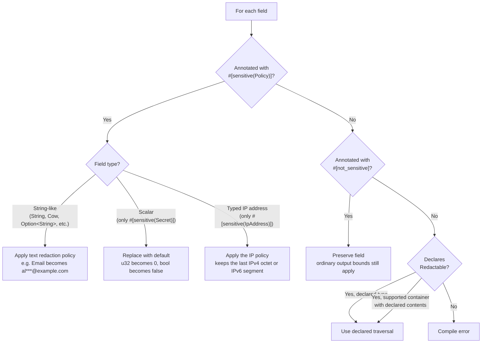
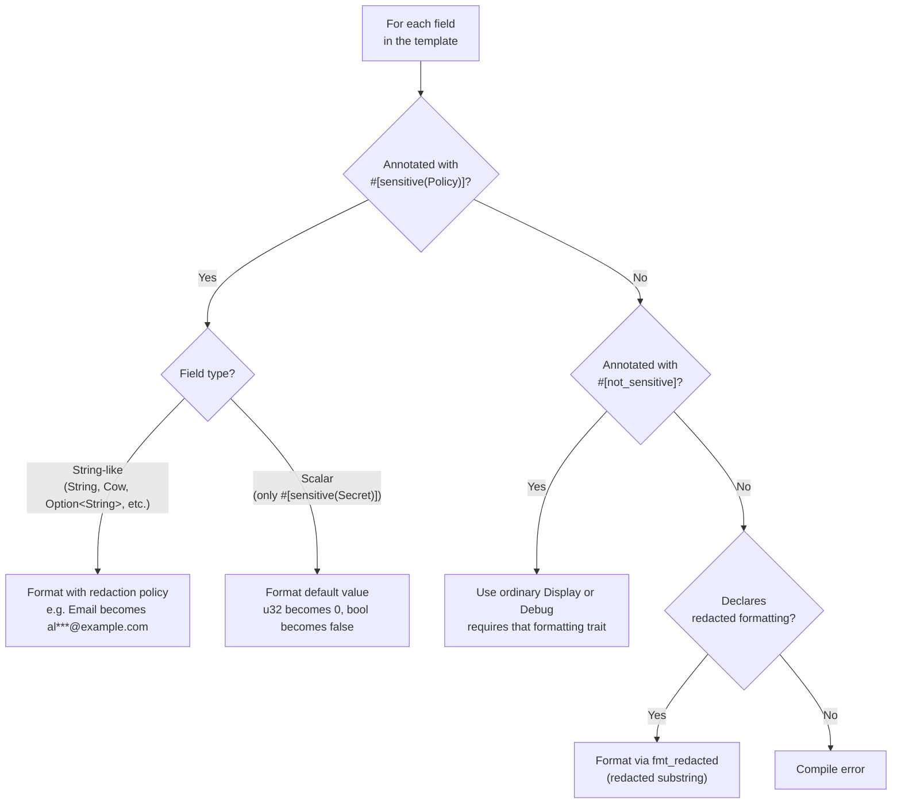

# Redactable

`redactable` is a redaction library for Rust. It lets you mark sensitive data in
your structs and enums and produce redacted values for logging and telemetry.
Redaction is not tied to any logging framework.

## Contents

- [Getting started](#getting-started)
- [Design principles](#design-principles)
- [How Sensitive works](#how-sensitive-works)
- [How SensitiveDisplay works](#how-sensitivedisplay-works)
- [When you need both: SensitiveDual](#when-you-need-both-sensitivedual)
- [NotSensitive and NotSensitiveDisplay](#notsensitive-and-notsensitivedisplay)
- [Wrapper types](#wrapper-types)
- [Integrations](#integrations)
- [Logging safety](#logging-safety)
- [Choosing what to use](#choosing-what-to-use)
- [Policies and reference](#policies-and-reference)

## Getting started

Which derive to use depends on what you need back: a structured value or
formatted text.

Use `Sensitive` when you want to keep working with the original type.
`.redact()` turns a `User` into a `User` with its sensitive fields redacted.
You can then serialize that value or pass it to another part of your application.

Use `SensitiveDisplay` when you need text, such as an error message or a log line.
You write a template, and the derive formats its fields with redaction applied.
`.redacted_display()` gives you a view you can format directly or turn into a
`String` with `.to_string()`.

If you need both, [SensitiveDual](#when-you-need-both-sensitivedual) combines the
two derives. The [choosing guide](#choosing-what-to-use) also covers non-sensitive
types and logging adapters.

### Quick examples

These examples use the 0.15 series and require Rust 1.97 or later.
The structured example also uses Serde to make the redacted value serializable:

```toml
[dependencies]
redactable = "0.15"
serde = { version = "1", features = ["derive"] }
```

**Structured** (`Sensitive`), with a redacted copy:

The email examples model restricted support logs whose operators use a mailbox
prefix and domain to correlate delivery failures. That application permits both
fragments. Use `Secret` where those fragments have no diagnostic purpose.

`.redact()` consumes its input. Clone first when you want to keep the original,
as this example does:

```rust
use redactable::{Email, Redactable, Sensitive};

#[derive(Clone, Sensitive, serde::Serialize)]
struct User {
    #[not_sensitive]
    name: String,
    #[sensitive(Email)]
    email: String,
}

let user = User { name: "alice".into(), email: "alice@example.com".into() };
let redacted = user.clone().redact();
assert_eq!(redacted.name, "alice");
assert_eq!(redacted.email, "al***@example.com");
```

**Formatted text** (`SensitiveDisplay`):

```rust
use redactable::{RedactableWithFormatter, Secret, SensitiveDisplay};

#[derive(SensitiveDisplay)]
enum AuthError {
    #[error("login failed for {user} with {password}")]
    InvalidCredentials {
        #[not_sensitive]
        user: String,
        #[sensitive(Secret)]
        password: String,
    },
}

let err = AuthError::InvalidCredentials {
    user: "alice".into(),
    password: "hunter2".into(),
};
assert_eq!(
    err.redacted_display().to_string(),
    "login failed for alice with [REDACTED]"
);
```

## Design principles

The library follows three principles:

1. **You decide what each field may reveal.** Apply a policy with
   `#[sensitive(Policy)]`, or declare a public field with `#[not_sensitive]`.
   A nested type can make those decisions for its own fields by deriving redaction.
2. **Traversal is automatic.** An `Option<User>` delegates to its `User`, and a
   `Vec<User>` visits each user. You do not write the traversal yourself.
3. **Both paths use the same annotations.** The policy on a field means the same
   thing whether you need a redacted value or formatted text.

A plain `String` does not tell the compiler whether it holds a password or a
public message. That is why raw fields need an explicit decision.
An undecided primitive field fails to compile when structural traversal or a template references it.

### Choose what diagnostics retain

Start with the output's audience and purpose. Restricted operator diagnostics
need useful names, IDs, branches, titles, labels, paths, messages, counts, and
relevant review content to explain work. Public outputs may need another view.

Mask concrete credentials, unnecessary personal data, and values covered by a
stated domain confidentiality rule. A field is not secret merely because it is
`String`, free-form, caller-supplied, internal, or stored in a private repository.
The possibility of an embedded secret does not justify masking the whole field.
Redactable applies your declared policies; it does not detect secrets in content.

Use `Secret` for credentials unless a documented diagnostic need justifies a
retained fragment. Other partial policies also need that disclosure decision.
Keep nested types' policies intact. A public declaration skips them, so review
the entire representation before choosing passthrough.

Use a typed diagnostic view when the original representation cannot retain
useful context with the required protection. Output limits control volume
separately from confidentiality; report omitted counts or size limits clearly.
Keep original business values for operations and raw serialization that need them.

### What redaction protects

Redaction applies when you use a redacted API or a generated logging integration.
Accessing `user.email` still gives you the original field. Serializing `user`
directly still gives you the original data, too: APIs and databases often need it.
For redacted serialization, redact the value first or use `.to_redacted().json()`.

A policy can preserve part of a value, such as an email domain or token suffix.
Choose a policy that reveals only what your logs should contain.
Generated `Debug` keeps its production redaction in tests and with the `testing`
feature enabled.

There are differences between traversal, generated `Debug`, and individual
logging adapters. The sections below show their output; the
[reference](docs/reference.md) covers ownership, borrowing, and type restrictions.

## How Sensitive works

`Sensitive` walks a struct or enum field by field and returns a value of the same type.
Producing its JSON through `ToRedacted` requires `Clone + Serialize`.
The containing type must not implement
[`Drop`](docs/reference.md#types-that-implement-drop).

Each field tells it what to do:

| Field | What happens |
|---|---|
| `#[sensitive(Policy)]` | Apply the policy to the value, including through supported containers |
| `#[not_sensitive]` | Keep the whole field unchanged, including any nested sensitive data |
| A nested type deriving `Sensitive` | Walk that type's fields and apply its annotations |
| A supported container such as `Option<T>` or `Vec<T>` | Delegate to its contents, which must also declare redaction behavior |
| Opaque `serde_json::Value` | Follow the [payload-specific rules](#json-payloads-need-an-output-view) |
| An undecided scalar or string field | Compile error |

For example, `Address` below declares what to do with its fields. `Account`
does not, so the `account` field makes this example fail to compile:

```rust,compile_fail
use redactable::{Secret, Sensitive};

#[derive(Clone, Sensitive, serde::Serialize)]
struct Address {
    #[not_sensitive]
    city: String,
}

#[derive(Clone, Debug, serde::Serialize)]
struct Account {  // Does NOT derive Sensitive
    password: String,
}

#[derive(Clone, Sensitive, serde::Serialize)]
struct User {
    address: Address,       // ✅ container, walks into it
    #[not_sensitive]
    name: String,           // ✅ explicitly public, unchanged
    #[sensitive(Secret)]
    api_key: String,        // ✅ annotated leaf, policy applied (redacted)
    account: Account,       // ❌ ERROR: Account does not declare Redactable behavior
}
```

### How nested values compose

The traversal code uses `RedactableWithMapper` to work with different types
through one interface. Containers delegate to their contents; standard leaves
such as `String` and `u32` provide a no-op implementation.

That low-level implementation is not a decision about sensitivity. The derive
also requires `Redactable` on unannotated fields, so a raw `String` still needs a
policy or `#[not_sensitive]`.

During map traversal, keys remain unchanged; redaction applies to the values.

Here is what that means for nested values. An explicitly public `Option<String>`
stays unchanged, while an `Option<Inner>` lets `Inner` redact its own secret:

```rust
use redactable::{Redactable, Secret, Sensitive};

#[derive(Clone, Sensitive, serde::Serialize)]
struct Inner {
    #[sensitive(Secret)]
    secret: String,
}

#[derive(Clone, Sensitive, serde::Serialize)]
struct Outer {
    #[not_sensitive]
    name: String,                   // explicitly public, unchanged
    #[not_sensitive]
    age: u32,                       // explicitly public, unchanged
    #[not_sensitive]
    maybe_string: Option<String>,   // explicit passthrough of the whole option
    maybe_inner: Option<Inner>,     // Option delegates; Inner is walked and redacted
    #[sensitive(Secret)]
    secret: Option<String>,         // #[sensitive(Secret)] applies through the Option
}

let outer = Outer {
    name: "alice".into(),
    age: 30,
    maybe_string: Some("visible".into()),
    maybe_inner: Some(Inner { secret: "hidden".into() }),
    secret: Some("also_hidden".into()),
};
let redacted = outer.redact();

assert_eq!(redacted.name, "alice");                               // unchanged
assert_eq!(redacted.age, 30);                                     // unchanged
assert_eq!(redacted.maybe_string, Some("visible".into()));        // unchanged
assert_eq!(redacted.maybe_inner.unwrap().secret, "[REDACTED]");   // walked and redacted
assert_eq!(redacted.secret, Some("[REDACTED]".into()));           // policy applied
```

### JSON payloads need an output view

With the default `redaction` feature, `serde_json::Value` is an opaque traversal
leaf. Structural redaction replaces the whole payload with `"[REDACTED]"`.
This fallback has no field-level knowledge; it does not classify every JSON
value as secret. `Sensitive`'s generated `Debug` instead delegates an unannotated
JSON field to its original `Debug`, which can expose the entire payload.

For useful diagnostics, select known fields into a typed view with their own
policies. Keep the raw payload for business use. This example preserves review
context and protects a concrete credential:

```rust
use redactable::{Secret, Sensitive, ToRedacted};
use serde::Serialize;
use serde_json::json;

#[derive(Clone, Sensitive, Serialize)]
struct Event {
    #[not_sensitive]
    request_id: String,
    payload: serde_json::Value,
}

#[derive(Clone, Sensitive, Serialize)]
struct ReviewDiagnostic {
    #[not_sensitive]
    request_id: String,
    #[not_sensitive]
    title: String,
    #[sensitive(Secret)]
    access_token: String,
}

let event = Event {
    request_id: "review-42".into(),
    payload: json!({"title": "Improve routing", "access_token": "example-access-token"}),
};
assert_eq!(event.to_redacted().json()["payload"], "[REDACTED]");
assert!(format!("{event:?}").contains("example-access-token"));

let view = ReviewDiagnostic {
    request_id: event.request_id.clone(),
    title: event.payload["title"].as_str().unwrap().to_owned(),
    access_token: event.payload["access_token"].as_str().unwrap().to_owned(),
};
assert_eq!(view.to_redacted().json(), json!({
    "request_id": "review-42", "title": "Improve routing", "access_token": "[REDACTED]"
}));
assert!(!format!("{view:?}").contains("example-access-token"));
assert_eq!(event.payload["access_token"], "example-access-token");
```

Send the view through the selected logging adapter. Declaring the raw JSON
`#[not_sensitive]` would bypass the fallback and expose all current and future
fields. The [reference](docs/reference.md#generated-debug-and-ordinary-display)
describes the separate `Debug` and traversal contracts.

### What if a field has no redaction declaration?

For a raw leaf, choose a policy or `#[not_sensitive]`. For a type containing its
own fields, the choice depends on whether you own the type:

- **Local types:** derive `Sensitive` on the type so it participates in traversal:

  ```rust
  use redactable::Sensitive;

  #[derive(Clone, Sensitive, serde::Serialize)]
  struct Account { /* ... */ }  // now implements RedactableWithMapper
  ```

- **Foreign types:** if the whole field is public, use `#[not_sensitive]`.
  For example, with a timeout type from another crate:

  ```rust
  use redactable::{Redactable, Sensitive};
  # mod external_crate {
  #     #[derive(Clone, Debug, serde::Serialize)]
  #     pub struct Timeout(pub u64);
  # }
  use external_crate::Timeout;

  #[derive(Clone, Sensitive, serde::Serialize)]
  struct Config {
      #[not_sensitive]
      timeout: Timeout,  // skips RedactableWithMapper entirely
  }
  let config = Config { timeout: Timeout(30) };
  assert_eq!(config.redact().timeout.0, 30);
  ```

  `#[not_sensitive]` is the declaration for a non-sensitive foreign field. When the foreign value is sensitive, [Wrapper types for foreign types](#foreign-types) shows the `SensitiveValue<T, P>` route.

### The `#[sensitive(Policy)]` attribute

`#[sensitive(Policy)]` tells the derive how to transform a field. The policy
also applies through supported containers, such as an `Option<String>`:

- `#[sensitive(Secret)]` on scalars: replaces the value with a default (0, false, `'*'`)
- `#[sensitive(Secret)]` on strings: replaces with `"[REDACTED]"`
- `#[sensitive(Policy)]` on strings: applies the policy's redaction rules

```rust
use redactable::{Email, Redactable, Secret, Sensitive};

#[derive(Clone, Sensitive, serde::Serialize)]
struct Login {
    #[not_sensitive]
    username: String,           // explicitly public, unchanged
    #[sensitive(Secret)]
    password: String,           // redacted to "[REDACTED]"
    #[sensitive(Email)]
    email: String,              // redacted to "al***@example.com"
    #[not_sensitive]
    attempts: u32,              // retained for diagnosing retries
}

let login = Login {
    username: "alice".into(),
    password: "example-password".into(),
    email: "alice@example.com".into(),
    attempts: 3,
};
let diagnostic = login.clone().redact();
assert_eq!(diagnostic.attempts, 3);
assert_eq!(diagnostic.password, "[REDACTED]");
assert_eq!(login.password, "example-password");
```

`#[sensitive(Secret)]` accepts both bare primitive names such as `u32` and qualified standard-library paths such as `std::primitive::u32`.

### Generic fields

A generic type must state the redaction requirements of its fields. The compiler
checks the definition even if you never call `.redact()` or log a value.

For an unannotated `value: T`, require `T: Redactable`:

```rust
use redactable::{Redactable, Secret, Sensitive, SensitiveValue, ToRedacted};

#[derive(Clone, Sensitive, serde::Serialize)]
struct Envelope<T: Redactable> {
    value: T,
}

let event = Envelope {
    value: SensitiveValue::<String, Secret>::from("hidden".to_owned()),
};
assert!(!format!("{event:?}").contains("hidden"));
assert!(!event.to_redacted().text().contains("hidden"));
```

Removing that bound rejects the definition itself:

```compile_fail
use redactable::Sensitive;

#[derive(Clone, Sensitive, serde::Serialize)]
struct Envelope<T> {
    value: T,
}

fn main() {}
```

Bounds apply to the complete field type. A `std::marker::PhantomData<T>` field
does not require `T: Redactable`.

### How the Sensitive macro processes each field



## How SensitiveDisplay works

`SensitiveDisplay` starts from a template. It formats only the fields the template
references; omitted fields never appear in that text.

This is useful for errors. An error can hold a connection, a retry context, and
credentials, while its message includes just a redacted account name.

The derive implements `RedactableWithFormatter` and formats by reference.
The generated text/secret path needs no `Clone`. Some policy projections have
extra requirements, described in the [reference](docs/reference.md#supported-types).

- A policy redacts a field before formatting it.
- `#[not_sensitive]` uses the field's ordinary `Display` or `Debug` implementation.
- A nested type can supply its own declared redacted formatting.
- A raw field referenced without a declaration produces a compile error.

In this example, `InnerError` supplies its own redacted text. `ExternalContext`
only implements ordinary `Display`, so the `ctx` field makes compilation fail:

```rust,compile_fail
use redactable::{RedactableWithFormatter, Secret, SensitiveDisplay};
use std::fmt::{Display, Formatter, Result as FmtResult};

#[derive(SensitiveDisplay)]
enum InnerError {
    #[error("db password {password}")]
    Database {
        #[sensitive(Secret)]
        password: String,
    },
}

struct ExternalContext;  // Does NOT derive SensitiveDisplay
impl Display for ExternalContext {
    fn fmt(&self, f: &mut Formatter<'_>) -> FmtResult {
        f.write_str("external")
    }
}

#[derive(SensitiveDisplay)]
enum AppError {
    #[error("user {name} (attempt {count})")]
    UserError {
        #[not_sensitive]
        name: String,              // ✅ explicitly public text
        #[not_sensitive]
        count: u32,                // ✅ explicitly public count
    },

    #[error("auth: {password}")]
    AuthFailed {
        #[sensitive(Secret)]
        password: String,          // ✅ annotated, becomes "[REDACTED]"
    },

    #[error("caused by: {source}")]
    Nested {
        source: InnerError,        // ✅ nested type, redacted via RedactableWithFormatter
    },

    #[error("context: {ctx}")]
    WithContext {
        ctx: ExternalContext,      // ❌ ERROR: missing declared redacted formatting
    },
}

let err = AppError::UserError { name: "alice".into(), count: 3 };
assert_eq!(err.redacted_display().to_string(), "user alice (attempt 3)"); // scalars unchanged

let err = AppError::AuthFailed { password: "hunter2".into() };
assert_eq!(err.redacted_display().to_string(), "auth: [REDACTED]"); // policy applied

let err = AppError::Nested {
    source: InnerError::Database { password: "secret".into() },
};
assert_eq!(
    err.redacted_display().to_string(),
    "caused by: db password [REDACTED]"
); // nested redaction
```

### Template syntax

The display template comes from one of two sources:

**`#[error("...")]` attribute** (thiserror-style):

```rust
use redactable::SensitiveDisplay;

#[derive(SensitiveDisplay)]
enum ApiError {
    #[error("auth failed for {user}")]
    AuthFailed { #[not_sensitive] user: String },
}
```

**Doc comment** (same syntax as `displaydoc`, but parsed by the macro itself):

```rust
use redactable::SensitiveDisplay;

#[derive(SensitiveDisplay)]
enum ApiError {
    /// auth failed for {user}
    AuthFailed { #[not_sensitive] user: String },
}
```

Both support named placeholders (`{field_name}`), positional placeholders (`{0}`, `{1}`), and debug formatting (`{field:?}`).

An unannotated field with declared redacted formatting uses that formatting for
`{field:?}`. A `#[not_sensitive]` field uses ordinary `Debug`, including string
quotes and escaping. Use `{field}` for public text without those quotes.

Positional placeholders must be contiguous from `0`; `{1}` without `{0}` is
rejected. Dynamic width or precision, such as `{value:.*}`, and non-Display or
Debug specifiers, such as `{value:x}`, are also rejected.

### Why referenced fields need a declaration

Being able to format a value does not tell the compiler whether it is safe to
include. Standard strings and scalars provide the low-level formatting machinery,
but referenced raw fields still need a policy or `#[not_sensitive]`.
Containers pass that requirement on to their contents.

Constant templates and omitted fields need no declaration. `SensitiveDual` also
checks every structural field, including fields its template omits.
See the [manual formatter contract](docs/reference.md#manual-formatters) for
handwritten implementations.

For public fields, the declaration makes the intended output explicit:

```rust
use redactable::{RedactableWithFormatter, SensitiveDisplay};

#[derive(SensitiveDisplay)]
enum Event {
    #[error("user {name} (age {age}, active: {active})")]
    UserInfo {
        #[not_sensitive]
        name: String,       // formats as "alice"
        #[not_sensitive]
        age: u32,           // formats as "30"
        #[not_sensitive]
        active: bool,       // formats as "true"
    },
}

let event = Event::UserInfo { name: "alice".into(), age: 30, active: true };
assert_eq!(
    event.redacted_display().to_string(),
    "user alice (age 30, active: true)"
);
```

### What if a field has no redacted formatter?

If a referenced field has no declared redacted formatter, compilation fails.
For raw leaves, choose a policy or `#[not_sensitive]`. For other types:

- **Local types:** derive `SensitiveDisplay` on the type so it participates in redacted formatting:

  ```rust
  use redactable::SensitiveDisplay;

  #[derive(SensitiveDisplay)]
  enum DatabaseError {
      #[error("connection failed: {detail}")]
      Connection { #[not_sensitive] detail: String },
  }
  // Now DatabaseError implements RedactableWithFormatter
  ```

- **Foreign types:** if the field is public, use `#[not_sensitive]` to render
  its ordinary `Display`. For example, with a context type from another crate:

  ```rust
  use redactable::{RedactableWithFormatter, SensitiveDisplay};
  # mod external_crate {
  #     pub struct ErrorContext;
  #     impl std::fmt::Display for ErrorContext {
  #         fn fmt(&self, f: &mut std::fmt::Formatter<'_>) -> std::fmt::Result {
  #             f.write_str("upstream timed out")
  #         }
  #     }
  # }
  use external_crate::ErrorContext;

  #[derive(SensitiveDisplay)]
  enum AppError {
      #[error("context: {ctx}")]
      WithContext {
          #[not_sensitive]
          ctx: ErrorContext,  // renders via Display, skips RedactableWithFormatter
      },
  }
  let error = AppError::WithContext { ctx: ErrorContext };
  assert_eq!(error.redacted_display().to_string(), "context: upstream timed out");
  ```

  `#[not_sensitive]` is the declaration for a non-sensitive foreign field. See [Wrapper types for foreign types](#foreign-types) for the sensitive case.

### The `#[sensitive(Policy)]` attribute in templates

`#[sensitive(Policy)]` has the same policy behavior as `Sensitive`, but formats
the result into the template:

- `#[sensitive(Secret)]` on strings: replaces with `"[REDACTED]"`
- `#[sensitive(Secret)]` on scalars: replaces with the default value (`0`, `false`, `'*'`)
- `#[sensitive(Policy)]` on strings: applies the policy's redaction rules
- `#[sensitive(Policy)]` on containers such as `Option<String>` or `Vec<String>`: applies the policy to each contained string, then formats the redacted container in the template

```rust
use redactable::{Email, RedactableWithFormatter, Secret, SensitiveDisplay};

#[derive(SensitiveDisplay)]
enum AuthEvent {
    #[error("login by {email} with token {token} (attempt {attempt})")]
    Login {
        #[sensitive(Email)]
        email: String,              // becomes "al***@example.com"
        #[sensitive(Secret)]
        token: String,              // credential remains fully masked
        #[not_sensitive]
        attempt: u32,               // retained for diagnosing retries
    },
}

let event = AuthEvent::Login {
    email: "alice@example.com".into(),
    token: "sk-secret-12345".into(),
    attempt: 3,
};
assert_eq!(
    event.redacted_display().to_string(),
    "login by al***@example.com with token [REDACTED] (attempt 3)"
);
```

### Generic template fields

A policy-marked generic field needs a bound for the redacted formatting used by
its template. `PolicyDisplay<Secret>` lets a generic field use `Secret` with `{}`:

```rust
use redactable::{PolicyDisplay, Secret, SensitiveDisplay, ToRedacted};

#[derive(SensitiveDisplay)]
#[error("{value}")]
struct Generic<T: PolicyDisplay<Secret>> {
    #[sensitive(Secret)]
    value: T,
}

let record = Generic { value: 42_u32 };
assert_eq!(record.to_redacted().text(), "0");
```

Use `PolicyDebug<Secret>` for `{value:?}`, or both bounds when the template uses
both forms. The bounds describe the redacted output, so the original field
does not need to implement ordinary `Display` or `Debug`.

The compiler rejects a missing required bound at the type definition. A policy
field does not need `T: Redactable`: the field's annotation supplies its policy.
The reference covers [complete-type bounds](docs/reference.md#generic-declarations)
and [custom policy formatting](docs/reference.md#custom-policy-formatting).

### How the SensitiveDisplay macro processes each field



## When you need both: SensitiveDual

Sometimes the same type needs structured fields in one log and a short message
in another. Derive `SensitiveDual` to generate both paths from the same annotations.

Like `Sensitive`, it checks every structural field.
Like `SensitiveDisplay`, it also needs a template. Fields omitted from that
template still participate in structured redaction.
Producing both representations through `ToRedacted` requires `Clone + Serialize`.

```rust
use redactable::{Email, SensitiveDual, ToRedacted};

#[derive(Clone, SensitiveDual, serde::Serialize)]
#[error("login by {email}")]
struct Login {
    #[sensitive(Email)]
    email: String,
    #[not_sensitive]
    accepted: bool,
}

let login = Login { email: "alice@example.com".into(), accepted: true };
let output = login.to_redacted();
assert_eq!(output.text(), "login by al***@example.com");
assert_eq!(output.json()["email"], "al***@example.com");
assert_eq!(output.json()["accepted"], true);
```

`.redacted_display()` returns the template view. `.slog_redacted()` and
`.tracing_redacted()` use the template; `.slog_redacted_json()` uses the object.

## NotSensitive and NotSensitiveDisplay

A public type still needs to tell the redaction system that it is public.
That lets it compose with sensitive types and pass the same logging bounds.

For types you own, use `NotSensitive` for structured data or
`NotSensitiveDisplay` for a type with a public `Display` representation.
Both preserve the value during traversal and generate the enabled logging
integrations. Neither generates `Debug`; derive it separately if you need it.

These declarations apply to the whole type. They do not inspect its fields to
check whether your decision is correct.

### `NotSensitive`

`NotSensitive` is for types with no sensitive data that need to work inside `Sensitive` containers:

```rust
use redactable::{NotSensitive, Secret, Sensitive};

#[derive(Clone, Debug, NotSensitive, serde::Serialize)]
struct PublicMetadata {
    version: String,
    timestamp: u64,
}

#[derive(Clone, Sensitive, serde::Serialize)]
struct Config {
    #[sensitive(Secret)]
    api_key: String,
    metadata: PublicMetadata,  // ✅ NotSensitive provides RedactableWithMapper
}
```

### `NotSensitiveDisplay`

`NotSensitiveDisplay` is for types with no sensitive data that have a `Display` impl:

```rust
use std::fmt::{Display, Formatter, Result as FmtResult};
use redactable::{NotSensitiveDisplay, RedactableWithFormatter, ToRedacted};

/// Retry using backoff
#[derive(Clone, NotSensitiveDisplay)]
enum RetryDecision {
    Retry { delay_ms: u64 },
    Abort,
}

impl Display for RetryDecision {
    fn fmt(&self, f: &mut Formatter<'_>) -> FmtResult {
        match self {
            Self::Retry { delay_ms } => write!(f, "Retry after {}ms", delay_ms),
            Self::Abort => write!(f, "Abort"),
        }
    }
}
let decision = RetryDecision::Retry { delay_ms: 1000 };
assert_eq!(decision.redacted_display().to_string(), "Retry after 1000ms");
assert_eq!(decision.to_redacted().text(), "Retry after 1000ms");
assert_eq!(RetryDecision::Abort.to_redacted().text(), "Abort");
```

`NotSensitiveDisplay` works inside both `Sensitive` and `SensitiveDisplay`
containers. It uses the type's own `Display` implementation for text and leaves
it unchanged during structural traversal.

You can also derive the public `Display` implementation with `displaydoc`.
Add it as a dependency to use this version:

```rust
use redactable::{NotSensitiveDisplay, ToRedacted};

#[derive(Clone, displaydoc::Display, NotSensitiveDisplay)]
enum RetryDecision {
    /// Retry using backoff
    Retry,
    /// Do not retry
    Abort,
}
assert_eq!(RetryDecision::Retry.to_redacted().text(), "Retry using backoff");
assert_eq!(RetryDecision::Abort.to_redacted().text(), "Do not retry");
```

## Wrapper types

An attribute changes how the containing type redacts a field. A wrapper changes
the field's runtime type, so it can carry its policy wherever you pass it.

`SensitiveValue<T, P>` wraps a value with a policy. It provides redacted `Debug`,
`.redacted()` for the redacted form, and `.expose()` for deliberate raw access.
It has no `Display` implementation, so accidental `{}` formatting does not compile.
It also implements `ToRedacted` and the enabled slog/tracing integrations.

The `Bypass*` wrappers make an explicit public-data declaration. They are useful
for foreign values or APIs that require a redaction trait on the value itself.
For a public field in a type you own, `#[not_sensitive]` is usually enough.

### Choosing a wrapper

Choose a bypass wrapper only when its entire output is public. For a record
that mixes public and sensitive fields, use a sensitive derive or a separate
type containing just the fields you intend to log.

| Need | Use |
|---|---|
| Sensitive leaf with a policy | `SensitiveValue<T, P>` |
| Sensitive structured output | `Sensitive` or `SensitiveDual`; the derive produces the JSON |
| Restricted summary or selected shape | A log-view type deriving the shape you want, or `BypassDisplayRedaction(text)` for author-composed text |
| Public value logged with `Debug` | `BypassDebugRedaction<T>` |
| Public value logged with `Display` | `BypassDisplayRedaction<T>` |
| Borrowed value logged as raw JSON | `BypassJsonRedaction<'_, T>` |
| Foreign value at a `Redactable`-bounded boundary | `BypassRedaction<T>` |
| Public value using slog's native typed output, even without `Display` or `Debug` | `BypassRedactionMarker<T>` |

Bypass wrappers use tuple construction: `BypassJsonRedaction(&value)` or
`BypassDisplayRedaction(text)`. `BypassRedaction` and `BypassRedactionMarker`
do not implement `ToRedacted`, because neither chooses a logging format.

`BypassTextRedaction` remains available but is deprecated. Use
`BypassDisplayRedaction(text)` for new text output. Its `Debug` output differs
from the old wrapper; the [wrapper reference](docs/reference.md#wrapper-contracts)
explains the difference and lists their traits and accessors.

`BypassDebugRedaction`, `BypassDisplayRedaction`, and `BypassRedaction` serialize
and deserialize exactly like their inner value. Sensitive wrappers also preserve
raw data for transport and storage; their policy applies at the logging boundary.

For example, this serialization keeps the original string. It needs
`serde_json = "1"` as a direct dependency:

```rust
use redactable::{Secret, SensitiveValue, ToRedacted};

let token = SensitiveValue::<String, Secret>::from("secret".to_owned());
assert_eq!(serde_json::to_value(&token).unwrap(), serde_json::json!("secret"));
assert_eq!(token.to_redacted().text(), "[REDACTED]");
```

### Foreign types

You cannot derive redaction on types defined in another crate. Wrappers provide
the traversal traits those types need. With a policy type defined in your crate,
you can implement `SensitiveWithPolicy<P>` on the foreign type.

For a sensitive foreign type, define a [local policy](#custom-policies),
implement `SensitiveWithPolicy<P>`, and use `SensitiveValue`:

```rust
use redactable::{
    RedactionPolicy, Sensitive, SensitiveValue, SensitiveWithPolicy, TextPolicyKind,
    TextRedactionPolicy,
};

// Imagine this comes from a payments SDK.
// It exposes accessors but no redaction support.
#[derive(Clone, Debug, serde::Serialize)]
struct MerchantAccount {
    id: String,
    name: String,
    tax_id: String,
}

impl MerchantAccount {
    fn tax_id(&self) -> &str { &self.tax_id }
}

// The policy type must be local to your crate: that is what satisfies the
// orphan rule for the SensitiveWithPolicy impl on the foreign type.
#[derive(Clone, Copy)]
struct MerchantPii;

impl RedactionPolicy for MerchantPii {
    type Kind = TextPolicyKind;

    fn policy() -> TextRedactionPolicy {
        TextRedactionPolicy::keep_last(2)
    }
}

impl SensitiveWithPolicy<MerchantPii> for MerchantAccount {
    fn redact_with_policy(self, policy: &TextRedactionPolicy) -> Self {
        Self {
            id: self.id,
            name: policy.apply_to(&self.name),
            tax_id: policy.apply_to(&self.tax_id),
        }
    }
    fn redacted_string(&self, policy: &TextRedactionPolicy) -> String {
        format!("MerchantAccount({}, {})", policy.apply_to(&self.name), policy.apply_to(&self.tax_id))
    }
}

#[derive(Clone, Sensitive, serde::Serialize)]
struct PaymentConfig {
    merchant: SensitiveValue<MerchantAccount, MerchantPii>,
}
```

The example below shows both halves of the rule: a non-sensitive foreign field
declared with `#[not_sensitive]`, and `BypassRedaction<T>` at an API that
demands `Redactable` on the foreign value itself.

```rust
use redactable::{BypassRedaction, Redactable, Sensitive};

#[derive(Clone, Debug, serde::Serialize)]
struct ForeignConfig { timeout: u64 }  // (pretend this is from another crate)

#[derive(Clone, Sensitive, serde::Serialize)]
struct AppConfig {
    #[not_sensitive]
    foreign: ForeignConfig,  // passes through unchanged
}

// A boundary that bounds the value itself, not a field of yours:
fn store<T: Redactable>(value: T) -> T { value.redact() }

let kept = store(BypassRedaction(ForeignConfig { timeout: 30 }));
assert_eq!(kept.0.timeout, 30);
```

### Protecting individual fields

With an attribute, a `String` is still a `String`. Logging `user.email` directly
can expose it even when logging the containing `user` would redact it.

`SensitiveValue<T, P>` follows the field wherever it goes. Its `Debug` uses the
policy, and `.expose()` gives you deliberate access to the original value.
Use either an attribute on a bare field or an unannotated `SensitiveValue` field.

Formatting the wrapper applies its policy while its raw value remains available:

```rust
use redactable::{Secret, Sensitive, SensitiveValue};

#[derive(Clone, Sensitive, serde::Serialize)]
struct User {
    email: SensitiveValue<String, Secret>,
}

let user = User { email: SensitiveValue::from(String::from("alice@example.com")) };

assert_eq!(format!("{:?}", user.email), "SensitiveValue(\"[REDACTED]\")");
assert_eq!(user.email.redacted(), "[REDACTED]");
assert!(!format!("{user:?}").contains("alice@example.com"));
let raw = user.email.expose();
assert_eq!(raw, "alice@example.com");
assert_eq!(serde_json::to_value(&user).unwrap()["email"], "alice@example.com");
```

Compare with `#[sensitive(P)]` attributes, where the field is a bare type at runtime:

| | `#[sensitive(P)]` | `SensitiveValue<T, P>` |
|---|---|---|
| **Raw access** | Access the field directly | Call `.expose()` |
| **Display (`{}`)** | Shows raw value | ✅ Not implemented (won't compile) |
| **Debug (`{:?}`)** | Shows raw value | ✅ Shows policy-redacted value |
| **Serialization** | Shows raw value | Shows raw value |
| **slog/tracing safety** | ✅ Via container | ✅ Direct |

The attribute affects output generated for the containing type, not direct
formatting of the field. `Sensitive`'s generated `Debug` uses the generic
`[REDACTED]` placeholder. `SensitiveDisplay` and the display-selected `Debug`
generated by `SensitiveDual` use the declared template, so policy annotations
may preserve shaped fragments such as an email domain or token suffix.

Both forms serialize raw values. Redact the value before serializing it,
or use `.to_redacted().json()` for redacted JSON.
`SensitiveValue` is a leaf wrapper and does not walk nested field annotations.
Local structured types should derive `Sensitive` instead.

## Integrations

### slog

For structured records, use `.slog_redacted_json()` to keep the fields selected
by the type's policies. This example writes them through a JSON drain:

```toml
[dependencies]
redactable = { version = "0.15", features = ["slog"] }
serde = { version = "1", features = ["derive"] }
slog = "2.8"
slog-json = { version = "2.6", features = ["nested-values"] }
```

Structured slog output relies on nested-value support throughout the drain
stack. When using drains such as `slog-async` or `slog-json`, enable each
drain crate's `nested-values` feature as well. Enabling `redactable/slog`
enables the feature on `slog` itself, but not on separate drain crates.

For `Sensitive` and `SensitiveDual`, the adapter clones the value, redacts the
clone, and serializes it at the call. This work happens even if the drain later
filters the record. Prefer a small view when cloning or serializing the source
would be expensive. It leaves the original business value unchanged.

```rust
use redactable::{Secret, Sensitive};
use redactable::slog::SlogRedactedExt;
use serde::Serialize;
use slog::{Drain, Logger};

#[derive(Clone, Sensitive, Serialize)]
struct ReviewEvent {
    #[not_sensitive]
    request_id: String,
    #[not_sensitive]
    title: String,
    #[not_sensitive]
    attempts: u32,
    #[sensitive(Secret)]
    access_token: String,
}

let event = ReviewEvent {
    request_id: "review-42".into(),
    title: "Improve review routing".into(),
    attempts: 3,
    access_token: "example-access-token".into(),
};

let drain = slog_json::Json::default(std::io::stdout());
let logger = Logger::root(std::sync::Mutex::new(drain).fuse(), slog::o!());
slog::info!(logger, "review requested"; "event" => event.slog_redacted_json());
assert_eq!(event.access_token, "example-access-token");
```

The nested `event` object retains `request_id`, `title`, and `attempts` while
`access_token` is `"[REDACTED]"`.

Direct borrowed native output is a coarse fallback: passing `"event" => &event`
for a `Sensitive` or `SensitiveDual` value emits only `"[REDACTED]"`.
That path protects the complete value without cloning, but discards all of its
field context. Keep it when that placeholder is the intended output.
Use a typed diagnostic view and the JSON adapter when fields are needed.

**Leaf wrappers**: `SensitiveValue<T, P>` also implements `slog::Value`:

```rust
use redactable::{Secret, SensitiveValue};
use slog::{Discard, Logger};

let api_token: SensitiveValue<String, Secret> = SensitiveValue::from(String::from("sk-secret-key"));

let logger = Logger::root(Discard, slog::o!());
slog::info!(logger, "auth"; "token" => &api_token);
// Logged: "[REDACTED]"
```

`SensitiveDisplay` emits its redacted text. The public-data derives emit what you
declared public: raw JSON for `NotSensitive`, or raw `Display` text for
`NotSensitiveDisplay`.

### tracing

For structural values with any tracing subscriber, use the plain `tracing`
feature and log the redacted `Debug` form:

```toml
[dependencies]
redactable = { version = "0.15", features = ["tracing"] }
serde = { version = "1", features = ["derive"] }
tracing = "0.1"
```

With your application's tracing subscriber configured:

```rust
# use redactable_readme_examples::capture_tracing;
use redactable::{Email, Secret, Sensitive};
use redactable::tracing::TracingRedactedDebugExt;

#[derive(Clone, Sensitive, serde::Serialize)]
struct AuthEvent {
    #[sensitive(Secret)]
    api_key: String,
    #[sensitive(Email)]
    user_email: String,
    #[not_sensitive]
    action: String,
}

let event = AuthEvent {
    api_key: "sk-secret-key-12345".into(),
    user_email: "alice@example.com".into(),
    action: "login".into(),
};

// Redacts a clone before the value reaches the tracing subscriber.
# let fields = capture_tracing(|| {
tracing::info!(event = event.tracing_redacted_debug());
# });
# assert_eq!(fields["event"], "AuthEvent { api_key: \"[REDACTED]\", user_email: \"[REDACTED]\", action: \"login\" }");
# assert!(!fields["event"].contains("sk-secret-key-12345"));
assert_eq!(event.api_key, "sk-secret-key-12345");
// Production output: AuthEvent { api_key: "[REDACTED]", user_email: "[REDACTED]", action: "login" }
```

These policy fields use the full `[REDACTED]` placeholder in generated `Debug`,
including in tests and with the `testing` feature.

For typed structured logging, use the `valuable` integration. Upstream tracing
requires `RUSTFLAGS="--cfg tracing_unstable"` for `tracing::field::valuable`,
and the field expression must pass a reference through that adapter:

```toml
[dependencies]
redactable = { version = "0.15", features = ["tracing-valuable"] }
serde = { version = "1", features = ["derive"] }
tracing = "0.1"
valuable = { version = "0.1", features = ["derive"] }
```

Build this example with `RUSTFLAGS="--cfg tracing_unstable"`:

```rust
# use redactable_readme_examples::capture_tracing;
use redactable::{Email, Secret, Sensitive};
use redactable::tracing::TracingValuableExt;

#[derive(Clone, Sensitive, serde::Serialize, valuable::Valuable)]
struct AuthEvent {
    #[sensitive(Secret)]
    api_key: String,
    #[sensitive(Email)]
    user_email: String,
    #[not_sensitive]
    action: String,
}

let event = AuthEvent {
    api_key: "sk-secret-key-12345".into(),
    user_email: "alice@example.com".into(),
    action: "login".into(),
};

let redacted = event.tracing_redacted_valuable();
# let fields = capture_tracing(|| {
tracing::info!(event = tracing::field::valuable(&redacted));
# });
# assert_eq!(serde_json::from_str::<serde_json::Value>(&fields["event"]).unwrap(), serde_json::json!({
#     "api_key": "[REDACTED]", "user_email": "al***@example.com", "action": "login"
# }));
# assert!(!fields["event"].contains("sk-secret-key-12345"));
assert_eq!(event.api_key, "sk-secret-key-12345");
// Logged: {api_key: "[REDACTED]", user_email: "al***@example.com", action: "login"}
```

Unlike slog where `slog::Value` can be implemented automatically via the derive
macro, tracing's `Value` trait is sealed. The `valuable` crate provides the
structured data path, but `TracingRedactedValue<T>` is not itself a tracing field
value. `.tracing_redacted_valuable()` redacts first; `tracing::field::valuable`
adapts the binding for subscribers that support `valuable`.

`Valuable` can expose references to objects inside the redacted value, including
errors. If those objects allow mutation through a shared reference, newly
inserted data can appear in later output.

**For flat display values** (without `valuable`):

```rust
# use redactable_readme_examples::capture_tracing;
use redactable::{Email, Secret, SensitiveValue};
use redactable::tracing::TracingRedactedExt;

let api_key: SensitiveValue<String, Secret> = SensitiveValue::from(String::from("sk-secret-key-12345"));
let user_email: SensitiveValue<String, Email> = SensitiveValue::from(String::from("alice@example.com"));

# let fields = capture_tracing(|| {
tracing::info!(
    api_key = api_key.tracing_redacted(),
    user_email = user_email.tracing_redacted(),
    action = "login"
);
# });
# assert_eq!(fields["api_key"], "[REDACTED]");
# assert_eq!(fields["user_email"], "al***@example.com");
# assert_eq!(fields["action"], "login");
# assert!(!format!("{fields:?}").contains("sk-secret-key-12345"));
// Logged: api_key="[REDACTED]" user_email="al***@example.com" action="login"
```

The display path also works for `SensitiveDisplay`, `SensitiveDual`,
`NotSensitiveDisplay`, and other values that implement `ToRedacted`.

## Logging safety

The integrations redact values when you use their adapters. Your own logging
helpers can require those adapters too, making an accidental raw value a compile error.

### Enforcing redaction at compile time

`SlogRedacted` and `TracingRedacted` mark logging integrations with a declared
output policy. The five derives and `SensitiveValue`
implement them when the corresponding feature is enabled.

Requiring a marker is only useful if the helper also uses the correct adapter.
A helper that checks the bound and then formats a raw field can still leak data.
A marker also does not promise that native output preserves a record's fields.
Public declarations and bypasses remain the author's disclosure decision.

`BypassRedactionMarker` explicitly declares its wrapped value public. It implements
`TracingRedacted`, and also `SlogRedacted` when the wrapped value implements
`slog::Value`. The raw value itself remains unmarked.

For slog, use `SlogRedacted` with `slog::Value` and pass the value to slog's
field API:

The helper accepts a selected structured view and a protected leaf:

```rust
use redactable::{Secret, Sensitive, SensitiveValue};
use redactable::slog::{SlogRedacted, SlogRedactedExt};

macro_rules! slog_safe {
    ($logger:expr, $msg:literal; $($key:literal => $value:expr),* $(,)?) => {{
        fn assert_slog_safe<T: SlogRedacted + slog::Value>(_: &T) {}
        $(assert_slog_safe(&$value);)*
        slog::info!($logger, $msg; $($key => &$value),*);
    }};
}

#[derive(Clone, Sensitive, serde::Serialize)]
struct User {
    #[not_sensitive]
    user_id: u64,
    #[sensitive(Secret)]
    email: String,
}
let user = User { user_id: 42, email: "private-contact@example.com".into() };
let api_token = SensitiveValue::<String, Secret>::from("api-token-canary".to_owned());
let logger = slog::Logger::root(slog::Discard, slog::o!());
let user_fields = user.slog_redacted_json();
assert_eq!(user_fields.json()["user_id"], 42);
assert_eq!(user_fields.json()["email"], "[REDACTED]");
slog_safe!(logger, "user logged in"; "user" => &user_fields);

// ✅ Works: SensitiveValue implements SlogRedacted
slog_safe!(logger, "auth"; "token" => &api_token);  // SensitiveValue<String, Secret>
assert_eq!(user.email, "private-contact@example.com");
```

Raw strings fail the same marker bound:

```compile_fail
use redactable::slog::SlogRedacted;

fn assert_slog_safe<T: SlogRedacted + slog::Value>(_: &T) {}
let raw_email = String::from("private-contact@example.com");
assert_slog_safe(&raw_email);
```

For structural tracing fields, require the redacting extension trait and call
its adapter:

```rust
# use redactable_readme_examples::capture_tracing;
use redactable::{Secret, Sensitive};
use redactable::tracing::TracingRedactedDebugExt;

macro_rules! trace_safe {
    ($($key:ident = $value:expr),* $(,)?) => {{
        fn assert_tracing_safe<T: TracingRedactedDebugExt>(_: &T) {}
        $(assert_tracing_safe(&$value);)*
        tracing::info!($($key = $value.tracing_redacted_debug()),*);
    }};
}
#[derive(Clone, Sensitive, serde::Serialize)]
struct Request {
    #[not_sensitive]
    request_id: String,
    #[sensitive(Secret)]
    token: String,
}
let request = Request { request_id: "request-42".into(), token: "request-token-canary".into() };
# let fields = capture_tracing(|| {
trace_safe!(request = request);
# });
# assert!(fields["request"].contains("request-42"));
# assert!(fields["request"].contains("[REDACTED]"));
# assert!(!fields["request"].contains("request-token-canary"));
assert_eq!(request.token, "request-token-canary");
```

An undecided raw string cannot satisfy that structural-output bound:

```compile_fail
use redactable::tracing::TracingRedactedDebugExt;

fn assert_tracing_safe<T: TracingRedactedDebugExt>(_: &T) {}
let raw_token = String::from("raw-token-canary");
assert_tracing_safe(&raw_token);
```

### `ToRedacted` for custom pipelines

A custom logger needs one common input even when some types produce text and
others produce structured data. `ToRedacted` provides that input.
Its `.to_redacted()` method returns an owned `RedactedValue` that the logger
can read as text or JSON.

- `text()` returns the redacted text, or compact JSON when only JSON is available.
- `json()` returns the redacted JSON, or `{"message": text}` for a text-only value.
- `SensitiveDual` supplies both representations from the same call.

The five derives generate `ToRedacted` for you. The logger chooses its format
without needing to know which derive the application used.

A `Sensitive` type always produces JSON. On serialization failure, the JSON is
the fixed string `"[REDACTED]"`; serializer errors and input data are never
included.

If map keys can contain private identifiers, enable `mask-map-keys`. It replaces
map keys in `Sensitive` and `SensitiveDual` producer JSON with positional names
such as `[REDACTED-KEY-0]`. Names emitted through Serde's struct methods remain;
flattened fields and tags emitted as map keys are masked too. The feature also
protects the compact text produced from JSON-only output. Templates and ordinary
Serde serialization keep their existing behavior. The
[map-key output contract](docs/reference.md#map-key-output) explains public
declarations, nested maps and the feature's limits.

This logger accepts any `ToRedacted` value. The example also reads its JSON
representation, so add `serde_json = "1"` as a direct dependency:

```rust
use redactable::{BypassDisplayRedaction, Email, Sensitive, ToRedacted};
use serde::Serialize;

#[derive(Clone, Sensitive, Serialize)]
struct LoginResult {
    #[sensitive(Email)]
    owner: String,
    #[not_sensitive]
    accepted: bool,
}

fn capture(value: &impl ToRedacted) -> String {
    value.to_redacted().text()
}

let result = LoginResult { owner: "alice@example.com".into(), accepted: true };
assert_eq!(capture(&result), r#"{"accepted":true,"owner":"al***@example.com"}"#);
assert_eq!(
    result.to_redacted().json(),
    serde_json::json!({"accepted": true, "owner": "al***@example.com"})
);

// A plain string reaches the same sink through an explicit escape.
let public = BypassDisplayRedaction("public readiness message");
assert_eq!(capture(&public), "public readiness message");
assert_eq!(
    public.to_redacted().json(),
    serde_json::json!({"message": "public readiness message"})
);
```

For a different view of the same application data, define a separate log-view
type with its own derive. You can also implement `ToRedacted` manually by
delegating to a `Bypass*` wrapper for deliberately public output.
A second implementation on a type that already derives it will not compile.

`RedactedValue` has no public constructor, `From`, or `Deserialize` implementation.
It is computed when produced and retains no reference to the source.
The [output reference](docs/reference.md#output-and-adapter-contracts) explains
adapter bounds, cloning, and when borrowed adapters run.

### Optional and shared producers

An operation can return `Option<T>` and keep `T`'s chosen logging output.
`Some(value)` delegates to the producer without changing its text or JSON.
`None` and `()` produce JSON `null`.

This also works with a handwritten producer that borrows its data:

```rust
use redactable::{BypassDisplayRedaction, Email, RedactedValue, RedactionPolicy, ToRedacted};

struct Account<'a> {
    email: &'a str,
}

impl ToRedacted for Account<'_> {
    fn to_redacted(&self) -> RedactedValue {
        let email = Email::policy().apply_to(self.email);
        BypassDisplayRedaction(email).to_redacted()
    }
}

let result = Some(Account { email: "alice@example.com" });
assert_eq!(result.to_redacted().text(), "al***@example.com");
assert_eq!(None::<Account<'_>>.to_redacted().json(), serde_json::Value::Null);
assert_eq!(().to_redacted().json(), serde_json::Value::Null);
```

The bypass receives only the email after its policy runs. The account needs
neither `Clone` nor `Serialize`, and its original data remains available.

References, `Box<T>`, `Rc<T>`, and `Arc<T>` also forward to an existing producer.
These implementations require `ToRedacted`; structural `.redact()` support alone
does not make a value a producer. `Option<String>` therefore remains rejected.
The [composition contract](docs/reference.md#producer-composition) covers bounds,
nested options, and the loss of distinction between absent values and JSON null.

### Logging a list

Collections such as `Vec<T>` do not implement `ToRedacted` from their elements.
Use `RedactedList` to log a slice with a limit on how many items are included.

`RedactedList::new(&items, limit)` takes items implementing `ToRedacted` and a
`NonZeroUsize` limit. Its JSON has the shape `{"items": [...], "omitted": count}`.
Each included item uses its `json()` representation, including `{"message": text}`
for text-only values.

The list calls `to_redacted()` once for each included item, in order, and skips
omitted items. The omitted count remains visible. The limit controls item count;
it does not bound bytes, depth, allocations, or policy cost.

## Choosing what to use

### Which derive?

| What you need | Derive | Requirements |
|---|---|---|
| A redacted value of the same type, with JSON for logging | `Sensitive` | `Clone + Serialize` |
| Redacted text from a template | `SensitiveDisplay` | A template |
| Both structured data and template text | `SensitiveDual` | `Clone + Serialize` and a template |
| An entirely public type, logged as JSON | `NotSensitive` | `Serialize` |
| An entirely public type, logged through its own `Display` | `NotSensitiveDisplay` | `Display` |

`Sensitive`, `SensitiveDual`, and both non-sensitive derives support structural
traversal. `SensitiveDisplay`, `SensitiveDual`, and `NotSensitiveDisplay` support
redacted formatting. The sensitive derives generate redacted `Debug`; the two
non-sensitive derives leave `Debug` to you.

The [derive reference](docs/reference.md#what-each-derive-generates) lists the
individual traits and logging outputs.

### How to handle a field

| Situation | Use |
|---|---|
| A sensitive leaf | `#[sensitive(Policy)]` |
| A public field, including a foreign type | `#[not_sensitive]` |
| A nested type that declares redaction | Leave it unannotated so its own behavior applies |
| A sensitive field that needs protection when passed around alone | `SensitiveValue<T, P>` |
| A sensitive foreign type | `SensitiveValue<T, P>` with a local policy and `SensitiveWithPolicy<P>` |

### How to log

| Output | Use |
|---|---|
| slog, structured JSON | `.slog_redacted_json()` |
| slog, the type's chosen text representation | `.slog_redacted()` |
| tracing, the type's chosen text representation | `.tracing_redacted()` |
| tracing, redacted structural `Debug` | `.tracing_redacted_debug()` |
| tracing, typed structured data | `.tracing_redacted_valuable()` with the required unstable configuration |
| Your own logging pipeline | Require `ToRedacted`, then read `.text()` or `.json()` from its result |

Passing a borrowed `Sensitive` or `SensitiveDual` value directly to slog produces
`"[REDACTED]"`. Use `.slog_redacted_json()` when you want its redacted fields.

## Policies and reference

The [detailed reference](docs/reference.md) covers supported types, ownership and
borrowing, advanced derive options, and testing helpers.
For upgrades, start with the [upgrade notes](docs/reference.md#upgrading).

### Built-in policies

| Policy | Use for | Example output |
|---|---|---|
| `Secret` | Credentials and protected values requiring full masking | `0` / `false` / `'*'` / `[REDACTED]` |
| `Token` | Protected tokens with a justified diagnostic suffix | `************f456` (last 4) |
| `Email` | Email addresses | `al***@example.com` |
| `CreditCard` | Card numbers | `************1234` (last 4) |
| `Pii` | Personal text with justified final characters; no content detection | `******oe` (last 2) |
| `PhoneNumber` | Phone numbers | `*******4567` (last 4) |
| `IpAddress` | IP addresses | `0.0.0.100` for typed IPv4; text keeps the last 4 characters |
| `BlockchainAddress` | Wallet addresses | `************abcdef` (last 6) |

This table describes transformations. The [audience decision](#choose-what-diagnostics-retain)
determines whether a retained fragment belongs in your output.

### Custom policies

A policy gives a name to a transformation. Define a marker type and implement
`RedactionPolicy` to reuse it across fields. Suppose support staff need the last
two characters of a confidential payment reference to distinguish customer-supplied
references. This policy expresses that partial-disclosure decision:

```rust
use redactable::{RedactionPolicy, TextPolicyKind, TextRedactionPolicy};

#[derive(Clone, Copy)]
struct PaymentReference;

impl RedactionPolicy for PaymentReference {
    type Kind = TextPolicyKind;

    fn policy() -> TextRedactionPolicy {
        TextRedactionPolicy::keep_last(2)
    }
}
```

For short-input behavior and policy restrictions, see
[Precedence and edge cases](docs/reference.md#precedence-and-edge-cases).

Defining a policy chooses a transformation. It does not declare a custom value
safe for formatting or logging. For a custom or foreign value, use the
[foreign-type wrapper route](#foreign-types). For a bare custom leaf in a
template, use the [custom policy formatting contract](docs/reference.md#custom-policy-formatting).
A reviewed local formatter without `#[sensitive(Policy)]` implements
[`DeclaredFormatting`](docs/reference.md#manual-formatters) with
`RedactableWithFormatter`.

Documentation changes follow the [contributing notes](CONTRIBUTING.md).
